<p align="center">
  
</p>

<h1 align="center">SOMA · Astronaut Health Monitor</h1>

SOMA is a **web application** (it runs in the browser, with nothing to install) for health monitoring and decision support on long-duration space missions. Built for the NASA Space Apps Challenge 2026 challenge **Create Health Monitoring Software for Astronauts on Space Missions**. Made by team **Astro Coders 2026**: Raquel Cámara, Pablo Dueñas, Emilliano Recuenco and José Miguel Quílez.

<p align="center">
  
  
  
  
  
  
  
</p>

| Live web app | Backend API |
|---|---|
| [soma-crew.vercel.app](https://soma-crew.vercel.app/) | [API docs](https://backend-sandy-pi-25.vercel.app/docs/)

## Try the demo

Open the [live web app](https://soma-crew.vercel.app/) and you can explore it right away. No sign-up is needed: pick one of the four fictional crew profiles and enter its PIN.

| Profile | Role | PIN |
|---|---|---|
| Ana Vega | Commander | `1111` |
| Leo Soler | Crew | `2222` |
| Inés Vidal | Crew | `3333` |
| Noa Ríos | Crew | `4444` |

How access works:

- **Without a PIN** you see the shared crew screen: general status only. Private records stay locked.
- **With a profile PIN** you open that astronaut's private data: body map, alerts, measurements, history and routine.
- **Commander (Ana Vega)** also sees additional crew health and alert information.
- **Emergency** never asks for a PIN: the red Emergency button is always available.
- Three wrong PIN attempts lock the keypad for a short time.

## Features

### Crew dashboard and body map
View crew status, open an astronaut profile and navigate health systems through an interactive body map.

<p align="center">
  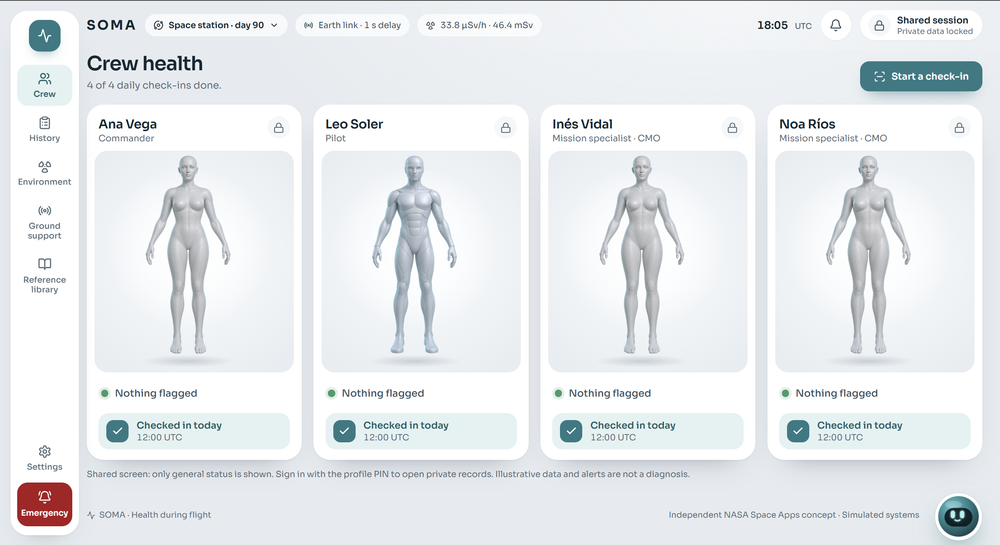
  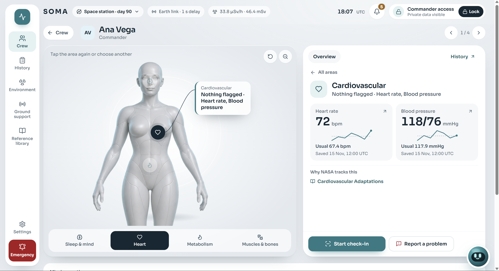
</p>

### Measurements and daily check-in
Record heart rate, blood pressure, blood sugar, temperature, sleep, mood, fatigue and exercise individually or as a daily check-in.

<p align="center">
  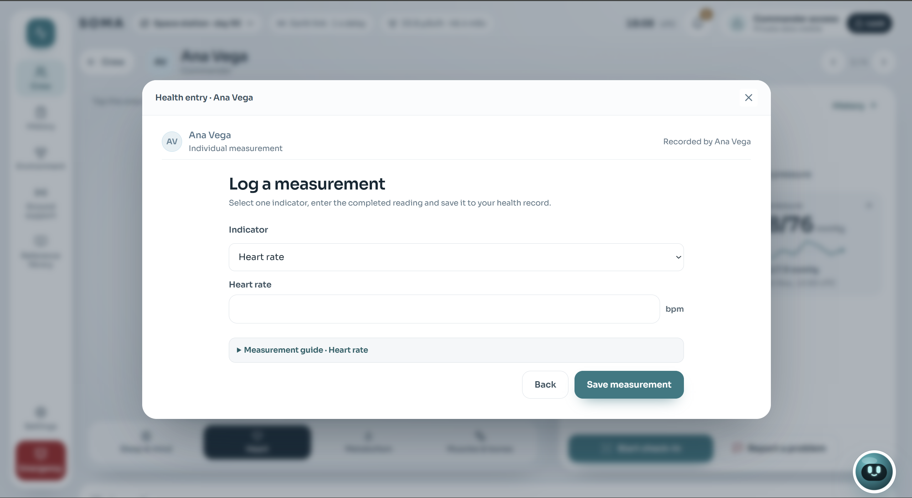
  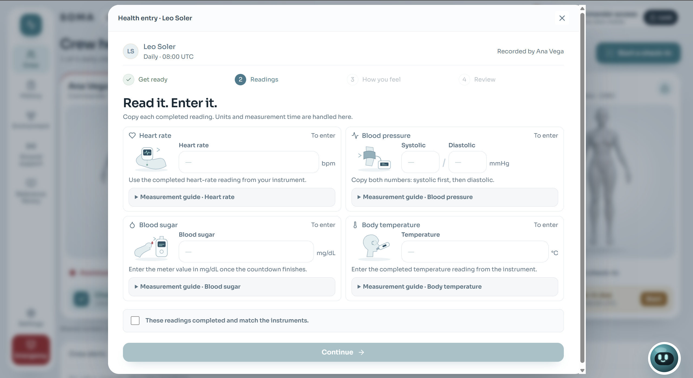
</p>

### Measurement guides
Read practical measurement instructions, context, illustrative ranges and suggested next steps for each indicator.

<p align="center">
  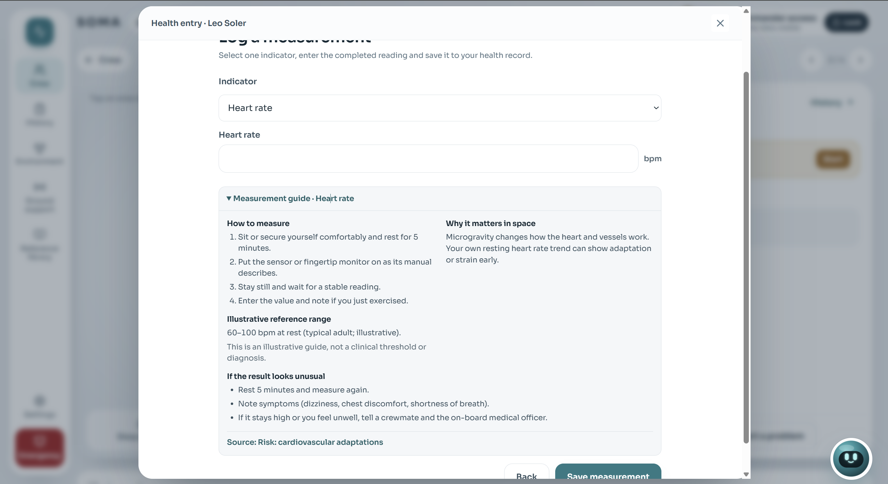
</p>

### Health alerts
See rule-based alerts with the reason, who should act, source references and suggested actions. Alerts are acknowledged in the app and are not diagnoses.

<p align="center">
  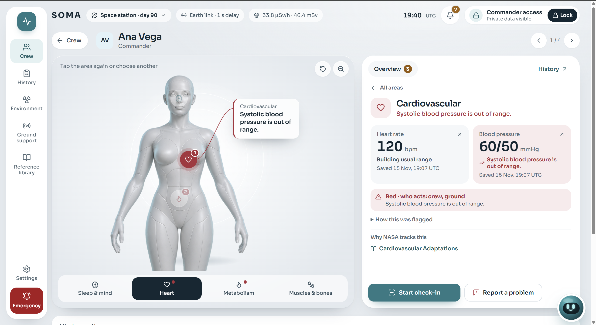
</p>

### Health history and trends
Review saved measurements over time and compare readings with a personal baseline.

<p align="center">
  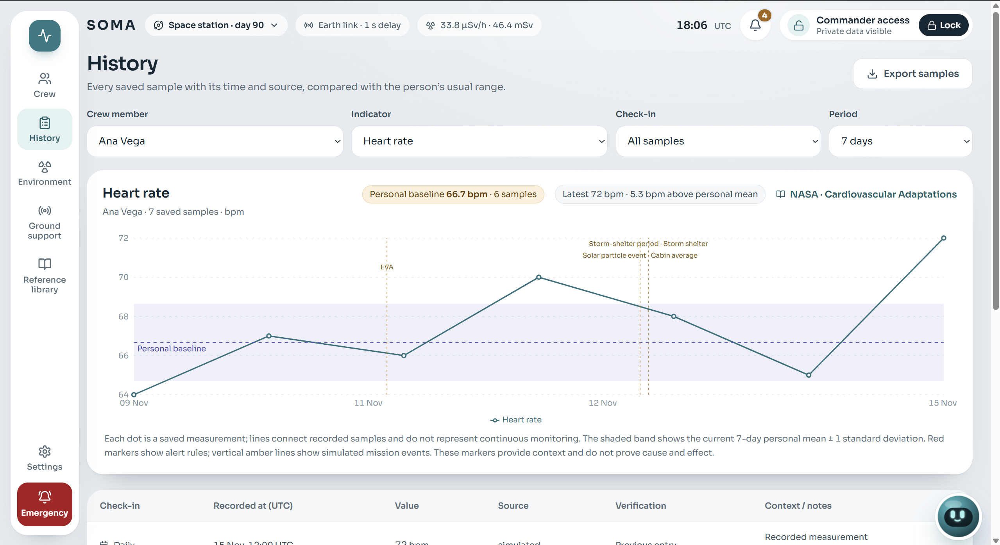
</p>

### Mission routine and reminders
See daily check-in, exercise and sleep/recovery tasks. Their due times adapt to station or transit environment, and completing a related measurement updates the routine.

<p align="center">
  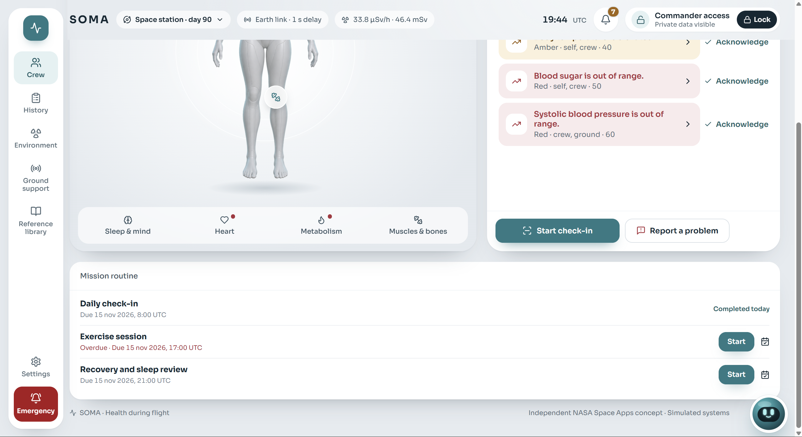
</p>

### Notifications
Review due check-ins, routine tasks and recent resolved alerts from the notification center.

<p align="center">
  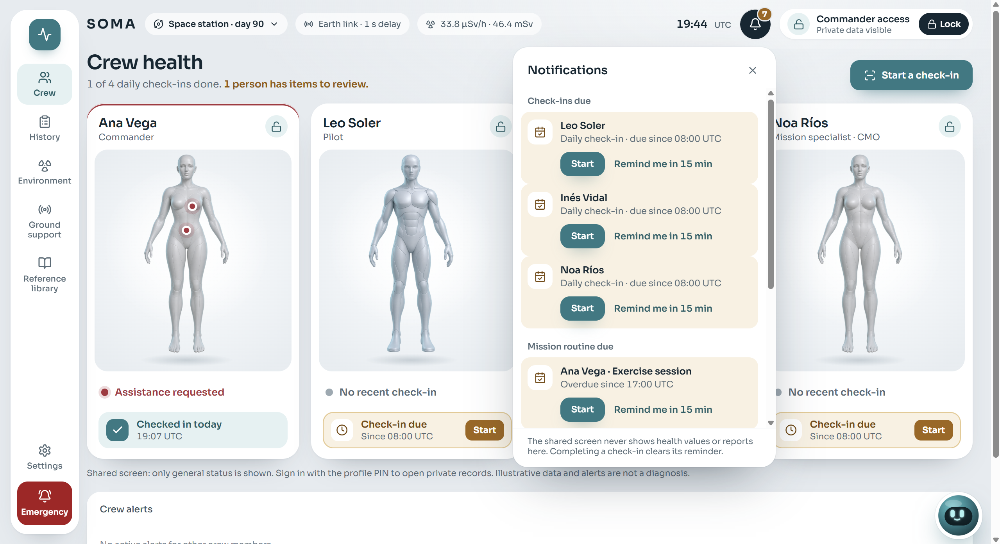
</p>

### Emergency mode
Follow a step-by-step guide for emergency scenarios and record a simulated onboard report. SOMA does not contact a real medical team. The guide also includes an **Ask SOMA** chat with the AI assistant, to ask questions about the step on screen.

<p align="center">
  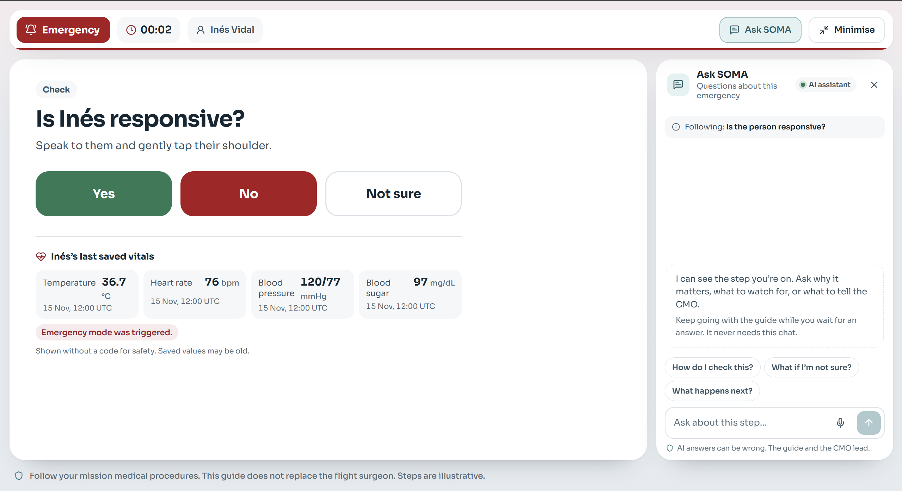
</p>

### Ground support report
Write a question or handover for the medical team on Earth, with saved data attached. Delivery is simulated; no real flight surgeon or medical service is contacted.

<p align="center">
  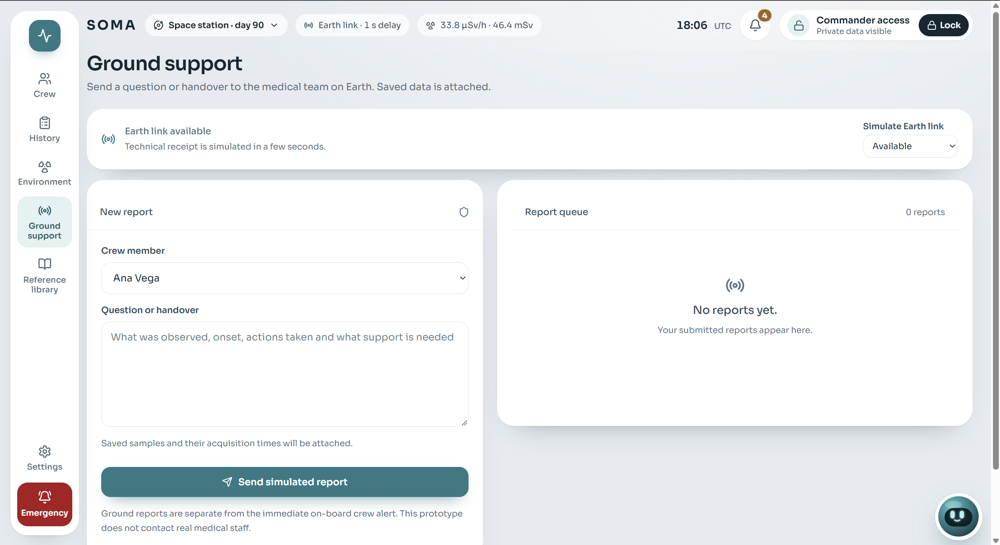
</p>

### Mission environment and radiation context
Switch between station and transit context, and inspect cabin-environment and radiation views. Radiation readings are simulated; no dosimeter is connected.

<p align="center">
  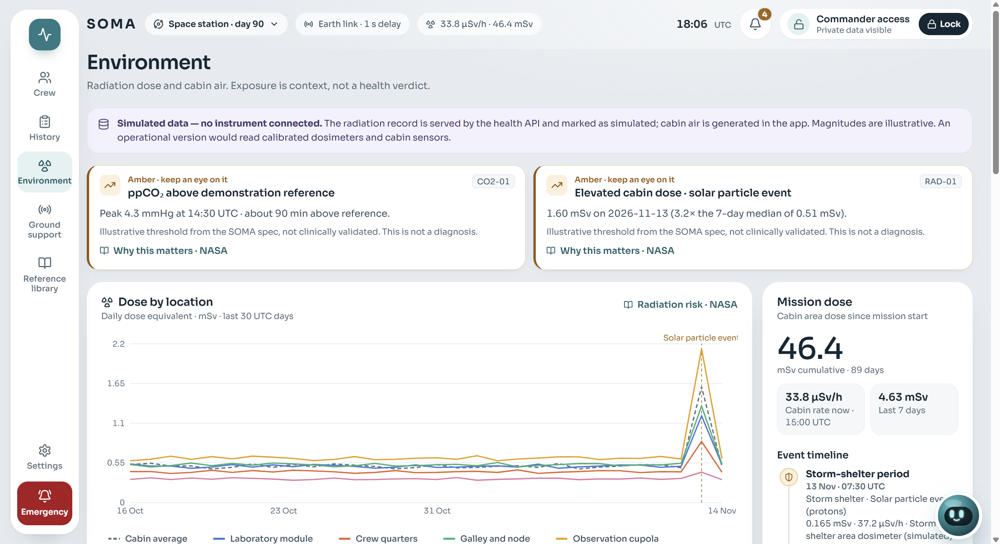
</p>

### Crew and commander view
Review crew-wide status. Commander access can open additional crew health and alert information.

<p align="center">
  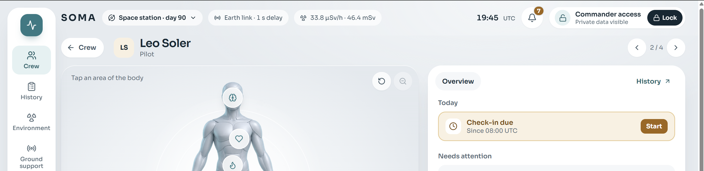
</p>

### Assistant and reference library
Ask questions about saved records and health topics; review the NASA/CSA references used by the prototype. The hosted AI provider is optional and the assistant does not diagnose.

**Voice:** ask by microphone (English) and press "Listen" to hear any answer read aloud, also in the Emergency chat. It uses the browser's built-in speech features, so it appears only where supported, and the browser's speech service may process the audio.

<p align="center">
  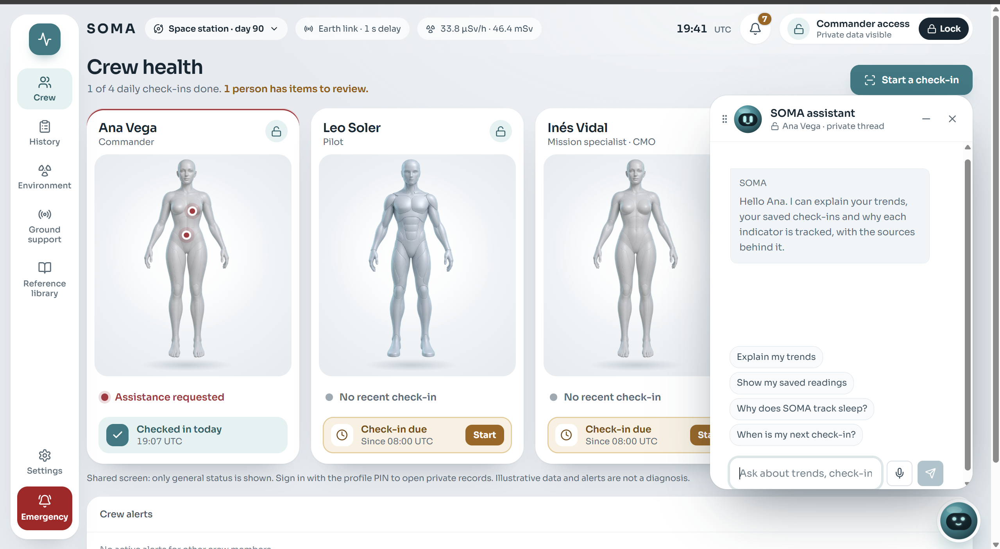
  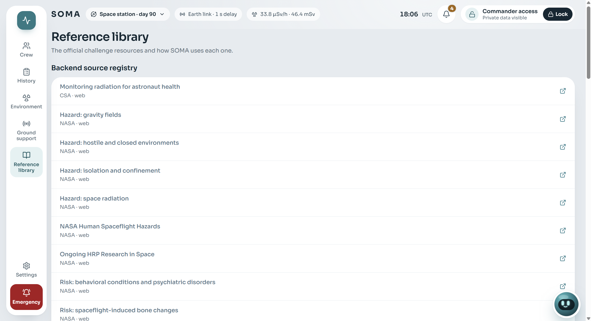
</p>

### Settings and accessibility
Adjust the app's appearance and supported accessibility preferences.

<p align="center">
  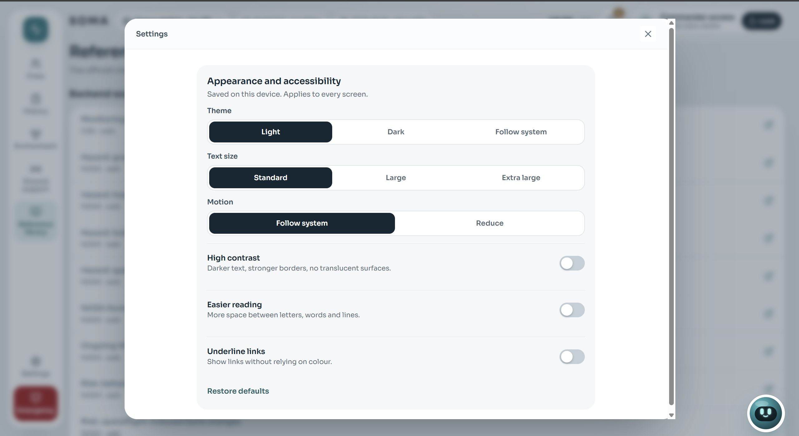
</p>

### Loading screen
While the app connects to the health service and loads crew and mission data, SOMA shows a loading screen.

<p align="center">
  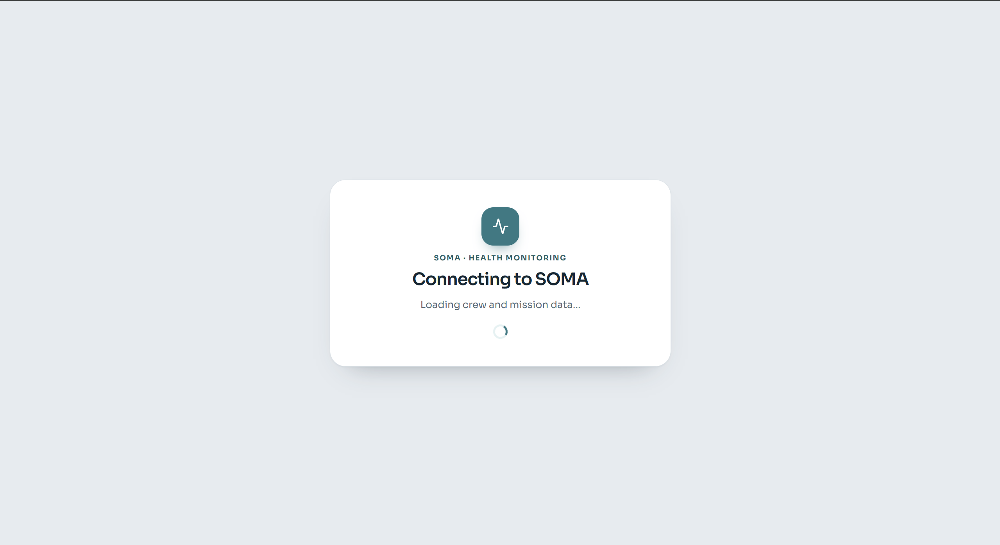
</p>

### Page not found
Unknown addresses show a 404 page with a button back to the home screen.

<p align="center">
  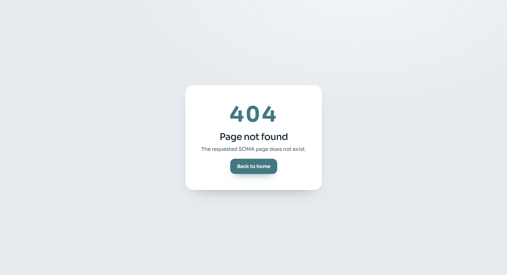
</p>

### Tablet layout
As a web app, SOMA is responsive and works in the browser on tablets as well as desktop screens: the side navigation moves to a bottom bar and the content reflows to fit the narrower width.

<p align="center">
  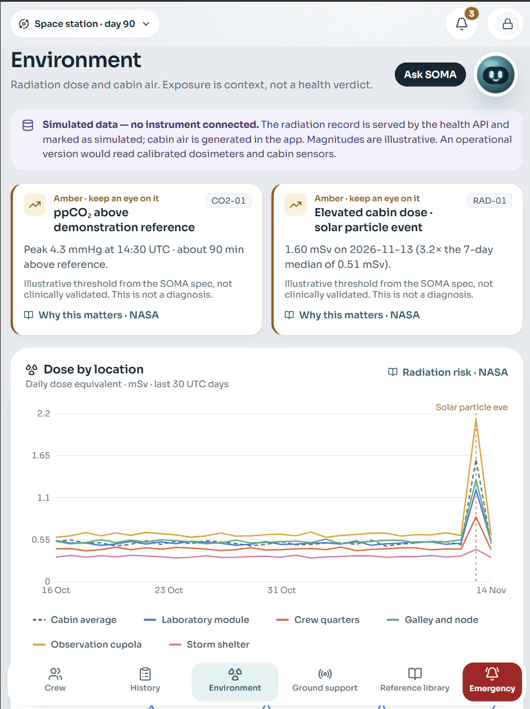
</p>

## AI usage and Spec-Driven Development

We used AI in two different ways, and we keep them separate on purpose.

### AI inside the product (runtime)

- The only AI feature is the optional **SOMA assistant**. It calls a hosted model through the OpenAI-compatible SDK, using the **free NVIDIA NIM API** (default model `nvidia/nemotron-3.5-super-vl-120b-a12b`, configurable with `LLM_MODEL`).
- **Rules decide, AI explains.** Statuses and alerts come from a deterministic, versioned rule engine. The model never computes risk or invents thresholds. It explains saved records and guides, cites sources and does not diagnose.
- The assistant runs a short, bounded loop (at most a few tool rounds per question) and only has **read-only** tools, scoped to the signed-in profile. Without a PIN it cannot see private data.
- If the key is missing or the provider fails, the chat reports that it is unavailable and logging, alerts, history, routine and Emergency mode keep working.
- It is a hosted service, so it is **not autonomous**: it would not work on a real mission without an on-board model. Any OpenAI-compatible server can replace it through `LLM_BASE_URL`.

### AI to build the project (development)

We built SOMA with AI coding assistants (including Claude Code) following **Spec-Driven Development (SDD)**: we wrote the specification first, and the AI implemented against it, instead of prompting for code. All specs live in [`docs/`](docs/):

| Step | Document | What it fixes |
|---|---|---|
| 1. Principles | [`constitution.md`](docs/constitution.md) | Ten non-negotiable rules that every spec, task and piece of code, human- or AI-written, must follow (not a medical device, rules decide and AI explains, honest data, no overclaiming…). |
| 2. Scope | [`features.md`](docs/features.md) | Features from the challenge statement, with priorities (P0, P1, stretch). |
| 3. Specification | [`spec.md`](docs/spec.md) | Requirements with ids (`HM-xx`, `MOD-xx`): users, privacy levels, indicators, alerts, emergency flow. |
| 4. Plan | [`plan.md`](docs/plan.md) | Stack and architecture. |
| 5. Contract | [`specs/api-contract.md`](docs/specs/api-contract.md) | The API shapes, declared as the source of truth: backend and frontend are both built against it. |
| 6. Tasks | [`tasks.md`](docs/tasks.md) | Ordered, small tasks. Working order per feature: contract, then implementation. |
| 7. Verification | [`verification.md`](docs/verification.md), [`specs/traceability.md`](docs/specs/traceability.md), [`testing.md`](docs/testing.md) | A checklist per requirement, plus REST Client and Cypress tests. |

## Data and limitations

- Crew profiles and seed measurements are fictional. Seeded readings are labeled `simulated`.
- Radiation and cabin-environment values are synthetic. SOMA does not integrate a NASA/CSA dataset or instrument, including CANS.
- Alert thresholds and suggested emergency actions are illustrative prototype rules, not clinically validated flight-medicine limits.
- Ground-support/report delivery is simulated; no real flight surgeon or medical service is contacted.

## Sources

- [NASA Human Spaceflight Hazards](https://www.nasa.gov/hrp/hazards/) — spaceflight hazard context.
- [NASA Human Spaceflight Risks](https://www.nasa.gov/hrp/risks/) — health-risk context for alerts and guides.
- [NASA Ongoing HRP Research in Space](https://www.nasa.gov/hrp/ongoing-hrp-research/) — research and measurement-design context.
- [CSA: Monitoring radiation for astronaut health](https://www.asc-csa.gc.ca/eng/news/articles/2026/2026-02-26-monitoring-radiation-astronaut-health.asp) — neutron-radiation and instrument context for the simulated radiation view.
- [CSA: Why conduct science experiments in space?](https://www.asc-csa.gc.ca/eng/iss/science/why-do-we-conduct-science-experiments-in-space.asp) — context for the value of space research.

The application presents these as references. No NASA/CSA dataset or instrument is integrated.

## Run locally

### Requirements

- Node.js 22.x and npm.
- A Supabase PostgreSQL project, or another PostgreSQL database compatible with Prisma.
- Git.

### 1. Configure and start the backend

From the repository root:

```bash
cp backend/.env.example backend/.env
```

Edit `backend/.env` with the database connection strings and a unique `JWT_SECRET`. Get the Supabase connection strings from the project's **Connect** panel; use the session/direct connection for `DIRECT_URL` (migrations) and a runtime-compatible connection for `DATABASE_URL`. Percent-encode reserved characters in the database password.

Then run:

```bash
cd backend
npm install
npm run prisma:generate
npm run prisma:migrate
npm run prisma:seed
npm run dev
```

The API listens on `http://localhost:3000`. Swagger UI is at [`http://localhost:3000/docs/`](http://localhost:3000/docs/) and the OpenAPI document at [`http://localhost:3000/docs/openapi.json`](http://localhost:3000/docs/openapi.json).

The normal seed is additive and creates fictional crew, check-ins, measurements, sources and routines when missing. `npm run prisma:seed:reset` overwrites seeded demo data; do not use it against a database containing data you want to keep.

### 2. Configure and start the frontend

In a second terminal, from the repository root:

```bash
cp frontend/.env.example frontend/.env.local
cd frontend
npm install
npm run dev
```

Open [`http://localhost:5173`](http://localhost:5173). `VITE_API_URL` must point to the backend. Vite exposes `VITE_*` values in the browser bundle, so never put database passwords, JWT secrets or AI-provider keys there.

## Environment variables

Use separate files for frontend and backend. The repository provides [`frontend/.env.example`](frontend/.env.example) and [`backend/.env.example`](backend/.env.example). Keep `.env` and `.env.local` files out of Git.

### Backend (`backend/.env`)

| Variable | Required | Purpose |
|---|---:|---|
| `DATABASE_URL` | Yes | PostgreSQL connection used by the API at runtime. |
| `DIRECT_URL` | Yes for Prisma CLI | Direct or session-pooler connection used for migrations. |
| `JWT_SECRET` | Yes | Signs backend session tokens; set a long random value. |
| `PORT` | No | Local API port; defaults to `3000`. |
| `LLM_API_KEY` | No | Enables the optional hosted assistant. Keep it backend-only. |
| `LLM_BASE_URL` | No | OpenAI-compatible provider URL; defaults to NVIDIA NIM. |
| `LLM_MODEL` | No | Provider model name. |
| `LLM_TIMEOUT_MS` | No | Optional assistant request timeout. |
| `LLM_COOLDOWN_MS` | No | Optional minimum pause between assistant requests. |

### Frontend (`frontend/.env.local`)

| Variable | Required | Purpose |
|---|---:|---|
| `VITE_API_URL` | Yes | Public base URL of the backend API, without a trailing slash. |

## Tests

### REST Client

1. Start the backend locally and make sure the database is migrated and seeded:

   ```bash
   cd backend
   npm run dev
   ```

2. Open [`backend/rest-client/api.http`](backend/rest-client/api.http) in VS Code with the **REST Client** extension installed.
3. Send the requests in order, starting with the health check and commander login. Keep the requests pointed at a local or dedicated test database, not production.

### Frontend Cypress E2E

1. Start the frontend in a terminal:

   ```bash
   cd frontend
   npm run dev:e2e
   ```

2. From another terminal in `frontend/`, open Cypress:

   ```bash
   npm run cypress:open
   ```

   Or run the browser flow headlessly:

   ```bash
   npm run cypress:run
   ```

